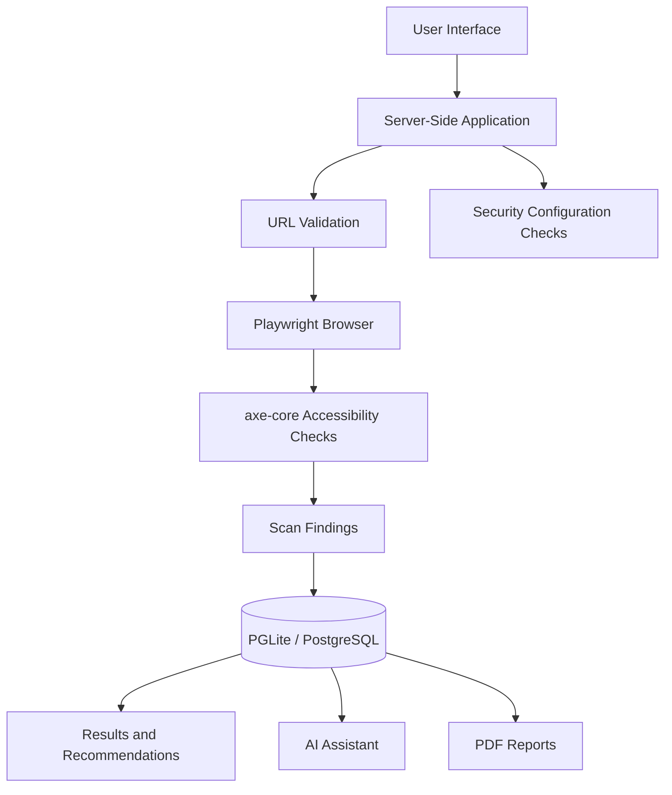

# CyberSense
### Evidence-Based Website Accessibility & Security Assessment

**Making the web more inclusive, one scan at a time.**

CyberSense is a web-based assessment platform developed for **Hackurity 2026 — Track D: Digital Inclusion, P7: Accessible by Default**.

It helps developers identify website accessibility issues, examine supporting evidence, understand possible fixes, track previous assessments, and generate PDF reports. It also includes a separate module for selected website security configuration checks.

## 🎯 Problem

Accessibility issues can make websites difficult to use for people with disabilities. Developers may overlook these issues during ordinary testing, and a score alone may not explain what needs to be fixed.

CyberSense focuses on making assessment results understandable and actionable by connecting automated checks with evidence, guidance, and reporting.

## ✨ Key Features

- **Automated Accessibility Scanning:** Uses Playwright and axe-core to inspect supported accessibility rules on a loaded webpage.
- **Evidence-Based Findings:** Presents detected rule violations and available information about affected elements.
- **Fix Recommendations:** Provides guidance based on recorded accessibility findings.
- **AI Assistant:** Helps explain selected findings using stored scan information, with a deterministic fallback when an external AI key is unavailable.
- **Scan History & Comparison:** Supports revisiting previous assessments and comparing findings.
- **PDF Assessment Reports:** Provides downloadable reports for documenting and reviewing results.
- **Security Configuration Checks:** Examines selected security evidence relating to HTTP headers, cookies, redirects, and TLS.
- **Scan Safety Controls:** Includes URL validation and restrictions intended to reduce unsafe server-side requests.

## 🏗️ Architecture

CyberSense connects the user interface, server-side application logic, scanning tools, and database storage.



The diagram shows the high-level workflow. The exact implementation details of each connection are described in the application documentation.

## 🚀 Quick Start

### Prerequisites

- Node.js version supported by the project
- npm
- A Chromium-based browser for browser-driven scans

### Install and run

From the repository root:

```bash
cd CyberSense
npm install
npm run dev:a11y-demo
```

Open the application:

**http://127.0.0.1:8080/accessibility**

To run the controlled accessibility demonstration, use this target:

`http://127.0.0.1:8080/a11y-demo`

Follow the authorization prompt and start the scan. Keep the development server running while using the application. Press `Ctrl+C` in its terminal to stop it.

For ordinary development, use `npm run dev`. The demo command enables the controlled local fixture workflow; it is intended for development, not public production deployment.

## 🧪 How to Run the Demo

1. Start the application using `npm run dev:a11y-demo`.
2. Open the Accessibility Scanner.
3. Enter the bundled demo target and confirm authorization.
4. Run the scan and inspect the findings and supporting evidence.
5. Open Fix Recommendations and the AI Assistant.
6. Review scan history and comparison functionality.
7. Download a PDF assessment report.
8. Explore the Security page to inspect the supported configuration checks.

The bundled `/a11y-demo` page is a synthetic test fixture with intentionally introduced accessibility defects. Its findings demonstrate the scanner's behaviour and are not results from an external production website.

## 🛠️ Tech Stack

| Technology | Purpose |
|---|---|
| React and TypeScript | User interface and application code |
| Vite | Development server and build tooling |
| TanStack Start and Node.js | Application routing and server-side functionality |
| Playwright | Browser automation |
| axe-core | Automated accessibility testing |
| PGLite / PostgreSQL | Assessment data storage |
| Security-check modules | Website security configuration assessment |

The PDF-generation implementation and any external AI integrations should be described according to the actual code and configuration.

## 📚 Documentation

- [Application README](CyberSense/README.md) — Features and application architecture
- [Setup and Demo Guide](CyberSense/docs/CYBERSENSE_SETUP_AND_DEMO.md) — Installation, environment configuration, persistence, demonstration steps, troubleshooting, and limitations

## ⚠️ Scope and Limitations

- Automated accessibility testing cannot detect every accessibility issue. Manual testing may be necessary.
- Security configuration checks are not a comprehensive vulnerability assessment or penetration test.
- Recommendations provide guidance; they do not automatically fix every website issue.
- The deterministic Assistant fallback is not a locally trained large language model.
- The bundled demo fixture is for controlled local testing.
- Only scan websites you own or are explicitly authorized to assess.

CyberSense supports evidence-based assessment and accessibility improvement; it does not guarantee that a website is completely accessible or secure.

## 👥 Team Members

1. PRAKUL P SHETTY
2. BALAJI N
3. SAKSHI CHIDANAND
4. SHREEYA MANJERI THOMAS 

## 🙏 Acknowledgements

CyberSense uses open-source libraries and tools, including Playwright and axe-core. See the project dependencies and applicable licences for attribution and licence details.
