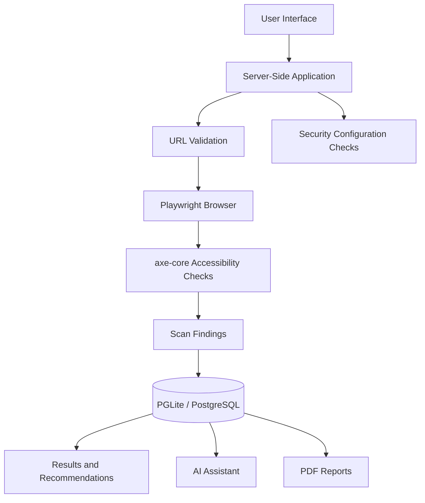

# CyberSense
### Evidence-Based Website Accessibility & Security Assessment

**Making the web more inclusive, one scan at a time.**

CyberSense is a web-based assessment platform developed for **Hackurity 2026 — Track D: Digital Inclusion, P7: Accessible by Default**.

It helps developers identify website accessibility issues, examine supporting evidence, understand possible fixes, track previous assessments, and generate PDF reports. It also includes a separate module for selected website security configuration checks.

## 🎯 Problem

Accessibility issues can make websites difficult to use for people with disabilities. Developers may overlook these issues during ordinary testing, and a score alone may not explain what needs to be fixed.

CyberSense focuses on making assessment results understandable and actionable by connecting automated checks with evidence, guidance, and reporting.

## ✨ Key Features

- **Automated Accessibility Scanning:** Uses Playwright and axe-core to inspect supported accessibility rules on a loaded webpage.
- **Evidence-Based Findings:** Presents detected rule violations and available information about affected elements.
- **Fix Recommendations:** Provides guidance based on recorded accessibility findings.
- **AI Assistant:** Helps explain selected findings using stored scan information, with a deterministic fallback when an external AI key is unavailable.
- **Scan History & Comparison:** Supports revisiting previous assessments and comparing findings.
- **PDF Assessment Reports:** Provides downloadable reports for documenting and reviewing results.
- **Security Configuration Checks:** Examines selected security evidence relating to HTTP headers, cookies, redirects, and TLS.
- **Scan Safety Controls:** Includes URL validation and restrictions intended to reduce unsafe server-side requests.

## 🏗️ Architecture

CyberSense connects the user interface, server-side application logic, scanning tools, and database storage.



The diagram shows the high-level workflow. The exact implementation details of each connection are described in the application documentation.

## 🚀 Quick Start

### Prerequisites

- Node.js version supported by the project
- npm
- A Chromium-based browser for browser-driven scans

### Install and run

From the repository root:

```bash
cd CyberSense
npm install
npm run dev:a11y-demo    # demo server (scanning the bundled fixture is allowed)
# or: npm run dev        # standard server (public targets only)
```

Open <http://127.0.0.1:8080/accessibility> and scan `http://127.0.0.1:8080/a11y-demo`. Stop the server with Ctrl+C in its terminal.

Full instructions — prerequisites, environment variables, database persistence, the complete demo workflow, troubleshooting and known limitations — are in [`CyberSense/docs/CYBERSENSE_SETUP_AND_DEMO.md`](CyberSense/docs/CYBERSENSE_SETUP_AND_DEMO.md). See also [`CyberSense/README.md`](CyberSense/README.md) for features and architecture.


**Third-party resources:** Any reused code, assets, datasets, or documentation must be credited to their original sources.